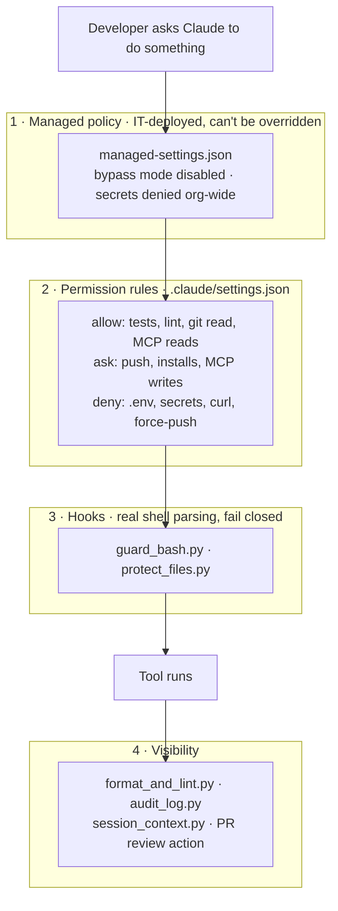

# Claude Code Team Workflow

## At a glance

- **What it is:** my reference setup for rolling out Claude Code to a dev team safely, so they get the speed without handing an AI agent their secrets or production.
- **Tech:** Claude Code (settings, permission rules, hooks, slash commands, subagents, skills, MCP), Python hooks, GitHub Actions with an automated Claude PR review, pytest, ruff.
- **How AI is used:** layered guardrails around a coding agent: least-privilege permissions, hooks that read shell commands the way a shell does and block destructive ones, protected secret files, an audit log with secrets redacted, and read-only review agents. A small lead-intake service gives everything real code to work on.
- **Skills it shows:** AI governance and security, Claude Code configuration, writing hooks that fail closed, and testing guardrails instead of trusting them.
- **How I built it:** I designed this and built it with Claude Code as my pair programmer. I set the goals and the rules, worked through the code and tests with Claude, and reviewed and tested every change myself.
- **Tests:** 210 checks that prove the guardrails hold.

## How it fits together

## What's inside

| Path | What it does |
|---|---|
| `CLAUDE.md`, `app/CLAUDE.md` | Project and directory memory: commands, layout, conventions, do / don't |
| `.claude/settings.json` | Least-privilege permission rules, hook wiring, MCP approval, bypass mode disabled |
| `.claude/hooks/guard_bash.py` | Parses shell commands like a shell (quotes, `&&`, `$(...)`, `bash -c`, `sudo`) and blocks destructive ones |
| `.claude/hooks/protect_files.py` | Blocks edits to secrets and lockfiles (including `app/../.env` and symlinks); asks before CI or guardrail edits |
| `.claude/hooks/format_and_lint.py` | Runs ruff on each edited Python file and feeds problems back to Claude |
| `.claude/hooks/session_context.py` | Starts each session with branch, uncommitted files and TODO count |
| `.claude/hooks/audit_log.py` | Append-only JSONL audit trail with secrets redacted |
| `.claude/commands/` | `/review`, `/test-fix`, `/new-endpoint`, `/handoff` |
| `.claude/agents/` | `code-reviewer` and `security-auditor` (read-only), `test-writer` |
| `.claude/skills/client-onboarding/` | Repeatable process to onboard a new client repo, with a report template |
| `.mcp.json` | Registers the [`leads-crm`](leads-mcp-server.md) MCP server: reads allowed, writes ask |
| `managed-settings.example.json` | Org-wide policy example; see docs/enterprise-policy.md |
| `.github/workflows/` | CI (tests + lint on Python 3.10–3.13) and Claude PR review |
| `docs/` | Permission modes, enterprise policy, ADR: defense in depth |

## What the guard catches (and what it doesn't)

| Blocked | Left alone |
|---|---|
| `rm -rf /`, `rm -fr ~`, `rm -r -f .`, `sudo rm --recursive --force /` | `rm build/tmp.txt` |
| `bash -c "rm -rf /"`, `ls; rm -rf /`, `false \|\| rm -rf /` | `echo "rm -rf / is dangerous"` |
| `git push -f origin main`, `git push origin +main`, `--force-with-lease` to main | `git push --force origin feature-x` |
| `git reset --hard` | `git log`, `git diff`, `git status` |
| `psql -c 'DROP TABLE leads'`, `chmod 777`, `curl ... \| sh`, `bash <(curl ...)` | `chmod 644 app/intake.py`, `grep -rf patterns.txt app` |
| `cat .env`, `head ./app/../.env`, `cp .env /tmp`, `source .env.production` | `cat .env.example` |
| `python3 -c 'import shutil; shutil.rmtree("/")'`, `perl -e 'unlink "/"'`, `node -e 'fs.rmSync("/")'`, `ruby -e 'FileUtils.rm_rf("/")'`, `os.system(...)`, `shell=True` | `python3 -c 'print(1)'`, `a.remove(x)` inside inline code |
| `docker run -v /:/host alpine rm -rf /host`, mounts of `~`, `.git`, `docker.sock` | `docker run -v .:/app ...`, named volumes |
| **Asks first:** `rm${IFS}-rf${IFS}/`, `$CMD ...`, `rm -rf $UNKNOWN_VAR`, `docker run -v /etc:/e ...` | `rm -rf build/`, `rm -rf $HOME/.cache/x` |

Every case in this table is a test in `tests/test_guard_bash.py`. Hooks are one layer, not a sandbox: for untrusted workloads, combine them with Claude Code's sandboxing and managed policy.

**Known limit:** the hook reads the command text, not the files it touches. A payload decoded into a file in one command and run in a later command (`base64 -d blob > x.sh && sh x.sh`) is not caught. The permission rules (`ask` for shells) and review are the backstop for that case.

## Webhook authentication

`handle_request(path, body, signature)` rejects unauthenticated deliveries. Each provider signs the **raw request body** with HMAC-SHA256 using a secret only it and you know, and sends the hex digest. The signature is checked (in constant time, with `hmac.compare_digest`) before the body is parsed.

| Situation | Response |
|---|---|
| Valid signature | `200` (or `400`/`422` if the body itself is bad) |
| Missing, malformed or wrong signature, or a body changed after signing | `401 {"error": "bad_signature"}` |
| No secret configured for the endpoint | `503 {"error": "webhook_secret_not_configured"}`: it fails closed instead of accepting leads unsigned |

**Setup for a deployer**

1. Generate one secret per endpoint: `python -c "import secrets; print(secrets.token_hex(32))"`.
2. Store it in the environment variable named for the endpoint: `WEBHOOK_SECRET_WEB_FORM` for `/webhooks/web-form`, `WEBHOOK_SECRET_INBOUND_CALL` for `/webhooks/inbound-call`. A new `/webhooks/<provider>` endpoint reads `WEBHOOK_SECRET_<PROVIDER>`. Use your secret manager, never the repository.
3. Give the same secret to the sending provider and configure it to send `hex(HMAC-SHA256(secret, raw_body))` in a header. A `sha256=` prefix is accepted.
4. In your web layer, pass that header value as the third argument: `handle_request(request.path, request.get_data(), request.headers.get("X-Signature"))`. Pass the exact bytes received, not re-serialized JSON.
5. Check it: `from app.webhook import sign; sign("your-secret", body)` produces the value a correct sender would send.

Rotate a secret by changing the variable and the provider's setting together. This protects against forged and tampered requests. It does not stop a captured valid request from being replayed; add a timestamp header if your provider supports one.

## Skills demonstrated

| Feature | Claude Certified Architect domain |
|---|---|
| Settings hierarchy, permission rules, hooks, slash commands, skills, CLAUDE.md memory | Claude Code Configuration & Workflows |
| Specialized subagents with scoped tools (read-only reviewers) | Agentic Architecture & Orchestration |
| `.mcp.json` server registration with read/write permission split | Tool Design & MCP Integration |
| Managed policy, defense in depth, fail-closed hooks, audit log | Governance, Safety & Risk Management (Professional) |
| Onboarding skill, handoff command, PR-review automation, CI | Developer Productivity & Operational Enablement (Professional) |

---

**Source code:** private. I'm happy to walk through it or give a live demo. All sample data is fictional (example.com emails, 555 phone numbers).

[Back to all projects](../README.md)
