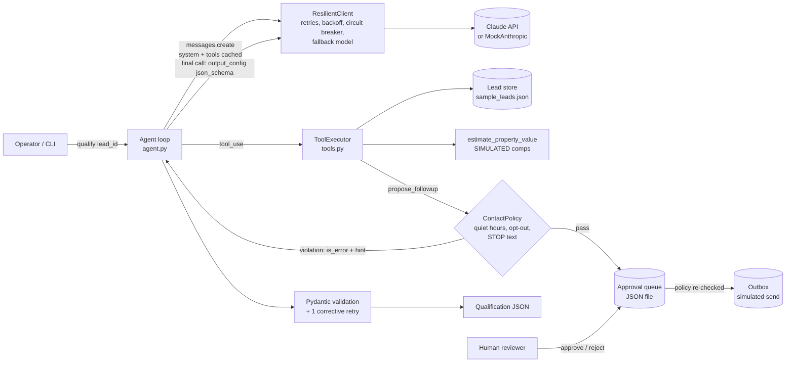

# Claude Lead Qualifier Agent

## At a glance

- **What it is:** a Claude agent that sizes up a new real-estate seller lead, scores it, and drafts a follow-up. A person approves every message before it goes out.
- **Tech:** Python 3.10+, the Anthropic SDK (Claude API with tool use, structured JSON output and prompt caching), Pydantic, pytest, GitHub Actions.
- **How AI is used:** Claude runs a tool-use loop over 5 tools to look the lead up, scores it against a written rubric, and returns JSON that is checked against a schema (with one retry if it's off). Contact rules like quiet hours and opt-outs live in code, so the model can't skip them. A small eval set of labeled leads measures how accurate it is.
- **Skills it shows:** agent loop design, tool design, human-in-the-loop approval, retries and fallback models, evals, and testing an AI app offline with a mock model.
- **How I built it:** I designed this and built it with Claude Code as my pair programmer. I set the goals and the rules, worked through the code and tests with Claude, and reviewed and tested every change myself.
- **Tests:** 116, all offline, no API key needed.

## What it does

```text
$ lead-qualifier qualify lead_c9d0e1f2 --mock
  -> get_lead -> check_contact_history + estimate_property_value (same turn) -> propose_followup
  -> structured Qualification JSON (validated) -> follow-up waiting in the approval queue
$ lead-qualifier approve act_xxxxxxxx      # a person decides; only then is it "sent" (simulated)
```

| Step | What happens | Where |
|---|---|---|
| Research | A hand-written agent loop calls 5 tools until Claude is done, or a step or token limit is hit | `agent.py`, `tools.py` |
| Score | Rubric: motivation 40, timeline 30, property condition 15, contactability 15 | `prompts/system.md` |
| Structure | The last call uses `output_config` JSON schema, then Pydantic checks it again. One retry if it fails | `schemas.py`, `agent.py` |
| Propose | `propose_followup` only adds an item to a queue. Code checks policy: quiet hours, opt-out, STOP text | `approval.py` |
| Approve | `approve` / `reject` from the CLI. Policy is checked again at approval time, then the send goes to a simulated outbox | `approval.py`, `cli.py` |
| Measure | 8 labeled leads. Reports tier/status accuracy, red-flag recall, tokens and steps | `evals/` |

## Architecture



More detail: docs/architecture.md,
ADR 0001: agent loop design,
ADR 0002: human approval gate.

## Sample output

This is a real mock run (`--mock --now 2026-10-09T14:00:00-04:00`). Action ids are random, and
token counts in mock mode are character-based estimates.

```text
== Lead qualification: lead_c9d0e1f2  [mock: offline simulated model]
status: complete
steps: 4  tools: get_lead, check_contact_history, estimate_property_value, propose_followup
tokens: 6169 budgeted (input 2858 + output 297 + cache write 3014); cache read 12056 not counted  [mock estimates]

agent summary: Linda Nguyen scores 96/100 (hot). Simulated ARV $649,000, max allowable offer $405,000. Proposed sms follow-up act_da70b7fa is waiting for approval.

qualification:
{
  "lead_id": "lead_c9d0e1f2",
  "score": 96,
  "tier": "hot",
  "motivation_summary": "Stated motivation: Behind on taxes; timeline: ASAP.",
  "timeline_bucket": "immediate",
  "red_flags": [
    "title_or_lien_issue"
  ],
  "recommended_status": "qualified",
  "next_action": {
    "type": "sms",
    "proposed_action_id": "act_da70b7fa",
    "summary": "Confirm motivation and timeline, then book a property walkthrough.",
    "timing": "Sat Oct 10, 10:00 ET"
  },
  "reasoning": "Motivation 36/40, timeline 30/30, condition 15/15, contactability 15/15."
}

PENDING HUMAN APPROVAL  act_da70b7fa  (sms at 2026-10-10T10:00:00-04:00)
  "Hi Linda, this is Sunshine Home Buyers about 301 Demo Palm Ave, West Palm Beach, FL. Do you have 10 minutes this week to talk about a cash offer? Reply STOP to opt out"
  approve: lead-qualifier approve act_da70b7fa
  reject:  lead-qualifier reject act_da70b7fa --reason "..."
```

The same run on a lead who texted STOP (`lead_b2c3d4e5`) comes back `disqualified`, with
`red_flags: ["opted_out"]` and `next_action.type: "none"`. The agent never calls
`propose_followup`, and if it did, the policy check would refuse it.

## Evaluation (mock)

`python -m evals.run --mock` runs 8 labeled leads (evals/dataset.json).
The labels are what an acquisitions manager would decide, not whatever the mock happens to
output. The set includes a probate case that never uses the word "probate", a prompt-injection
attempt in a free-text field, an opted-out lead, and a listed property.

Latest **mock** run (full report):

| Metric | Mock result |
|---|---|
| Tier accuracy | 88% (7/8) |
| Status accuracy | 100% (8/8) |
| Red-flag recall | 92% (11/12) |
| Contact proposed for a disqualified lead | 0 |
| Avg tokens (estimated, incl. cache writes) | 5,606 |
| Avg loop steps | 3.8 |

The two misses are on purpose: keyword rules can't spot an estate sale described in plain words,
and they don't treat injected instructions as "no motivation". Those are the cases a real model
should get right. Run `python -m evals.run` with an API key to measure Claude itself. No live
numbers are published here.

CI runs the mock evals on every push and fails the build if any disqualified lead gets a contact
proposal, or if tier accuracy drops below 75%.

## Skills demonstrated

Mapped to the Claude Certified Architect exam domains (CCAR-F) and practice themes (CCAR-P).

| Feature | Where | Domain / theme |
|---|---|---|
| Hand-written agentic loop: runs every `tool_use` block, returns all `tool_result`s in one turn, handles `end_turn` / `max_tokens` / `refusal` explicitly | `agent.py` | CCAR-F: Agentic Architecture & Orchestration |
| Hard stop limits (max steps, token budget) that end the run cleanly with `status: incomplete` and a reason | `agent.py` | CCAR-F: Agentic Architecture & Orchestration |
| Repo conventions for AI-assisted development (`CLAUDE.md`), ADRs, test-first changes, CI | `CLAUDE.md`, `docs/adr/`, `.github/` | CCAR-F: Claude Code |
| System prompt with role, numeric rubric, 2 few-shot examples, guardrails (no invented facts, flag missing data, treat lead text as data) | `prompts/system.md` | CCAR-F: Prompt Engineering & Structured Output |
| `output_config` JSON schema + Pydantic re-validation (score range, tier/score band, real action ids) + one corrective retry; enum values compared case-insensitively | `schemas.py`, `agent.py` | CCAR-F: Prompt Engineering & Structured Output |
| 5 strict tools (`strict: true`, `additionalProperties: false`), descriptions that say when to use each one, structured errors (`code` / `message` / `hint`) sent back with `is_error: true` | `tools.py` | CCAR-F: Tool Design & MCP |
| Prompt caching (`cache_control` on the system block and the last tool), tool results capped at a fixed size, compact search results | `agent.py`, `tools.py` | CCAR-F: Context Management & Reliability |
| Retries with exponential backoff + full jitter (429 / 5xx / 529 / connection), `retry-after`, circuit breaker, fallback model when overload persists, usage logging including `cache_read_input_tokens` | `client.py` | CCAR-F: Context Management & Reliability |
| Clean seams: the SDK client can be swapped (real / scripted fake / rule-based mock); the lead record uses the same core fields as the sibling MCP server (it adds direction-specific activity types such as `sms_inbound`) | `mock.py`, `store.py` | CCAR-P: Integration |
| Labeled eval set, metrics runner, markdown report, CI gate; 110+ offline unit tests | `evals/`, `tests/` | CCAR-P: Evaluation / Testing |
| Human approval gate, policy written in code and checked twice (when proposed and when approved), audit trail, simulated outbox, injectable clock | `approval.py` | CCAR-P: Governance / Safety |

## Design decisions

- **A hand-written loop, not a framework runner.** Each stop condition is visible in about 60
  lines and covered by a test. Before running tools, the loop checks the token budget, so a run
  it is about to abandon can't still queue a text message. See
  ADR 0001.
- **Research and structuring are separate calls.** The tool loop ends in plain text, then one
  final call with `tool_choice: none` and a JSON schema produces the record. System prompt and
  tools stay the same across calls, so the cached prefix is reused.
- **The schema limits shape; code enforces meaning.** Structured outputs can't express `0-100`
  or "this action id must exist", so Pydantic and a per-run check reject those mistakes. The
  error text goes back to the model once.
- **Only finished runs reach a reviewer.** If a run stops early (budget, step limit, refusal,
  invalid output), any follow-up it proposed is withdrawn from the queue.
- **Policy lives in code, not the prompt.** The prompt asks the model to respect quiet hours and
  opt-outs. `ContactPolicy` makes sure of it, and checks again at approval time, because a lead
  can text STOP between the proposal and the approval. See
  ADR 0002.
- **Failure modes are classified.** 400/401/403 are never retried and don't trip the circuit
  breaker (those are our bugs, not outages). Only persistent overload (529/503) triggers the
  fallback model. A 429 means slow down, not switch models.
- **Read-only CRM access.** The agent can't change lead records. It recommends a status, and a
  person applies it.
- **The valuation is clearly fake.** `estimate_property_value` hashes the address. Every result
  carries `simulated: true`, and the prompt says not to change a tier based on it alone.

## Limitations

- Sample data and valuations are fictional. This is a reference implementation, not a production
  CRM integration.
- Mock mode tests the plumbing, not Claude's judgment. The test suite and CI run fully offline,
  so they never call the real API.
- The approval queue is a local JSON file meant for a single operator.
- Quiet hours assume every lead is in `America/New_York`. A real deployment would work out the
  time zone from each lead's address or area code.

---

**Source code:** private. I'm happy to walk through it or give a live demo. All sample data is fictional (example.com emails, 555 phone numbers).

[Back to all projects](../README.md)
