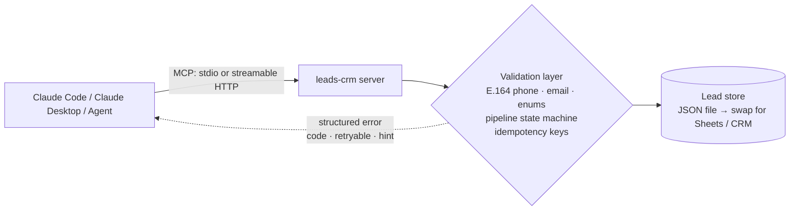
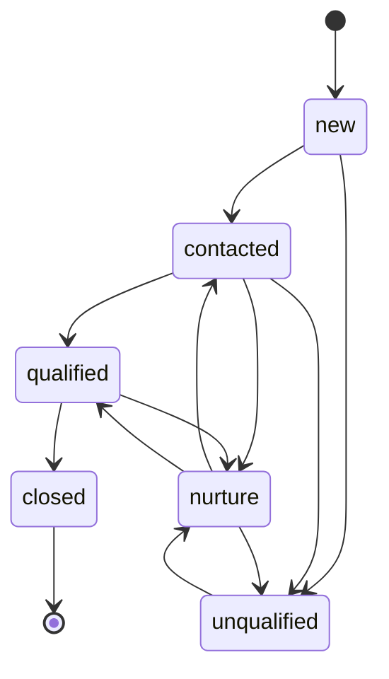

# Leads MCP Server

## At a glance

- **What it is:** an MCP server that lets Claude search, read, create and update leads in a small CRM without messing up the data.
- **Tech:** Python 3.10+, the official MCP Python SDK (stdio and streamable HTTP), pytest, GitHub Actions.
- **How AI is used:** this is the tool layer an AI agent calls. It's built around the ways agents really go wrong (retrying, guessing ids, skipping steps), with idempotency keys, a pipeline state machine, and clear error codes with hints so Claude can fix its own mistakes.
- **Skills it shows:** MCP tool, resource and prompt design, safe writes from an agent, input validation, and error messages written for a model to read.
- **How I built it:** I designed this and built it with Claude Code as my pair programmer. I set the goals and the rules, worked through the code and tests with Claude, and reviewed and tested every change myself.
- **Tests:** 42, all offline.

## How it fits together

## Why this exists

An LLM agent calling a CRM will retry on timeouts, guess IDs, and skip steps.
This server is designed so each of those fails safely:

| Agent mistake | What the server does |
|---|---|
| Retries `create_lead` after a timeout | The **idempotency key** returns the original lead and `created: false`, with no duplicate |
| Creates a lead that already exists | `DUPLICATE_LEAD` error that points to the existing lead id |
| Guesses a lead id | `LEAD_NOT_FOUND` with hint *"Call search_leads to find the correct id"* |
| Jumps a lead from `new` to `closed` | `INVALID_TRANSITION`, listing the allowed next statuses |
| Sends `305-555-0101` | `INVALID_PHONE`, with the expected E.164 format |
| Retries `update_lead_status` | Repeating the same status and score is a no-op, with no duplicate history entry |
| Tries to reopen a closed deal | `LEAD_CLOSED`: closed leads are final |

Business-rule errors come back as `isError: true` results whose text carries a JSON body
`{"error": {"code", "message", "retryable", "hint"}}`, so the model can recover on its own.
Malformed arguments (wrong type, value outside an enum) are rejected earlier by the MCP SDK's
schema validation, also as `isError: true`.

## Tools, resources and prompts

| Name | Type | Annotations | Purpose |
|---|---|---|---|
| `search_leads` | tool | read-only | Free-text / status / min-score search; compact results |
| `get_lead` | tool | read-only | Full record with activity history |
| `create_lead` | tool | idempotent | Create a lead (requires `idempotency_key`) |
| `update_lead_status` | tool | idempotent | Move through the pipeline with reason + score |
| `log_activity` | tool | write | Append call / SMS / email / note / opt-out |
| `leads://pipeline` | resource | — | Statuses and allowed transitions |
| `qualify_lead` | prompt | — | Reusable qualification workflow |

Pipeline (enforced by the server, not the prompt):

## Skills demonstrated

| Feature | Claude Certified Architect domain |
|---|---|
| Tool descriptions written for model tool selection, enum-constrained inputs | Tool Design & MCP Integration |
| Structured, recoverable errors (`isError` + code/retryable/hint) | Tool Design & MCP Integration |
| stdio + streamable HTTP transports | Tool Design & MCP Integration |
| Idempotency keys, file locking + atomic writes, server-side state machine | Context Management & Reliability |
| Compact list results vs full detail on demand | Context Management & Reliability |
| Read/write tool annotations to drive client permissions | Governance, Safety & Risk (Professional) |
| End-to-end protocol tests | Evaluation & Testing (Professional) |

Design reasoning is in ADR 0001.

## Roadmap

- Google Sheets / HubSpot backends behind the same `LeadStore` interface
- OAuth 2.1 for the HTTP transport
- Pagination cursors for large lead lists

---

Built by **Noah Williams** · MIT License · All sample data is fictional.

---

**Source code:** private. I'm happy to walk through it or give a live demo. All sample data is fictional (example.com emails, 555 phone numbers).

[Back to all projects](../README.md)
