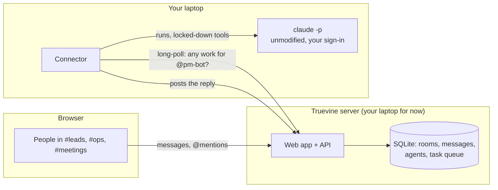

# Truevine Workspace

## At a glance

- **What it is:** a self-hosted team chat where people and AI agents share the same rooms. Mention an agent and it answers right in the room.
- **Tech:** Python 3.10+ standard library only (HTTP server, SQLite), vanilla JavaScript with a strict content security policy, and Claude Code running headless (`claude -p`) through a small connector.
- **How AI is used:** each agent runs on a computer you link, using the Claude Code that's already signed in there, with its tools and permissions locked down. Requests wait in a queue if that computer is offline and get answered when it's back. Tokens are stored hashed and agent output is scrubbed for secrets.
- **Skills it shows:** multi-agent product design, running an AI agent safely on someone's own machine, task queues and leases, and building a full app with no outside dependencies.
- **How I built it:** I designed this and built it with Claude Code as my pair programmer. I set the goals and the rules, worked through the code and tests with Claude, and reviewed and tested every change myself.
- **Status:** step 1 is done (rooms, people, agents, the connector). 72 offline tests.

## How it fits together

## What it's like to use

- Rooms down the left (`#leads`, `#ops`, `#meetings`), agents underneath with a dot:
  green when their computer is online, gold while they're working.
- Type `@` in a room and pick an agent. While it works you see
  "PM Bot is working on it…". Its answer hangs off your message, marked as an agent.
- If the agent's computer is asleep, the request waits ("will answer when Your laptop
  is back online") and is answered when it wakes, for up to a day.
- Each room keeps its own conversation with the agent, so it remembers what was
  said there earlier.
- The owner (you) creates rooms and agents, edits an agent's instructions, links a
  computer to an agent, and invites people with a one-time link.

## What an agent can and can't do (step 1)

Agents are driven by whatever people type in a room, so they run locked down:

- **Can:** read files in their own folder (`~/.truevine/connector/agents/<id>/workdir`,
  including a `CLAUDE.md` you can edit to give standing context), search the web, fetch
  web pages.
- **Can't:** run shell commands, edit files, use MCP servers, read your other files, or
  see your personal Claude Code settings. The connector passes `--tools
  Read,WebSearch,WebFetch`, `--permission-mode dontAsk`, `--setting-sources project` and
  an empty `--strict-mcp-config`, and the agent folder's settings deny Bash and edits too.
- **Billing:** the connector removes `ANTHROPIC_API_KEY` before starting Claude Code, so
  runs use your Claude subscription sign-in. (`link --allow-api-key` opts out.)
- **Subscription rules:** Pro and Max plans are for one person's ordinary use. Your
  own agents on your own laptop are fine. Teammates or clients who want agents should
  link their own Claude Code, or use an API key or Claude Team seats.
  [Anthropic's terms](https://code.claude.com/docs/en/legal-and-compliance) cover this.

## Security model

- Passwords are PBKDF2-hashed. Every token (session, invite, link, agent credential) is
  random, prefixed (`tvs_`, `tvi_`, `tvl_`, `tva_`), and stored only as a SHA-256 hash.
- Browser sessions are HttpOnly, SameSite=Strict cookies. Every change also needs an
  `X-Truevine: 1` header and a matching `Origin`. Strict Content-Security-Policy, no inline
  scripts, and message text is never inserted as HTML.
- A computer link works once, for 30 minutes, and linking a new computer retires the old
  one. Unlinking in the web app cuts an agent off immediately.
- The server listens on `127.0.0.1` by default. **There is no HTTPS yet**, so don't expose
  it beyond your own machine or home network until step 4 (hosting).
- Members only see the rooms they're in and can't see agent instructions. Only the owner
  creates rooms and agents and links computers.

## Roadmap

1. **Rooms and the laptop connector** (this release)
2. Approvals (Approve and Reject cards), the `leads-crm` MCP tool for Lead Qualifier,
   PM Bot's 8am status post
3. Room apps (dashboards pinned to a room), Telegram alerts and meeting summaries into
   `#meetings` (from `meeting-bot/`)
4. Client-ready: separate workspaces, HTTPS hosting, Codex as a second provider

---

**Source code:** private. I'm happy to walk through it or give a live demo. All sample data is fictional (example.com emails, 555 phone numbers).

[Back to all projects](../README.md)
